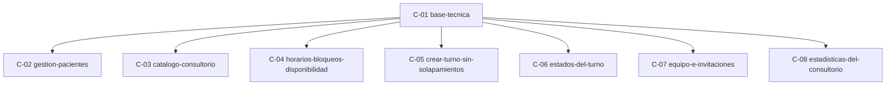

# CHANGES: secuencia de implementación

> Índice canónico de todos los changes del proyecto **Turnos Odontología**.
> Cada change es atómico: un agente puede implementarlo en una sesión (~4-6 horas) con el ciclo OPSX completo.
> **Leer este archivo antes de empezar un item.** Solo el líder lo modifica.

---

## Cómo usar este documento

1. **Identificar el item**: buscá tu change por ID (`C-NN`) y confirmá que su `Estado` es `[ ]` pendiente.
2. **Verificar dependencias y leer la KB**: todas las fichas de `Depende de` tienen que estar `[x]` en `main`. Leé los archivos de `Leer antes`; la knowledge base gana sobre cualquier guía o prompt.
3. **Acordar alcance y verificación**: corré explore → propose; revisá la propuesta (usá **Ajustar** si algo no coincide con la KB) y verificá que la spec tenga al menos 3 escenarios (feliz, error de negocio, borde) que citen los códigos `RN-XX-NN`.
4. **Verificar el resultado**: apply → verify; tests en verde, CI en verde y el `Resultado` de la ficha comprobado. Después archive y PR, tocando solo tu `Zona`.
5. **Actualizar estado**: al mergear, el líder marca la ficha `[x]` en `main` y avisa al resto para que hagan `git merge main`.

---

## Árbol de dependencias

```
C-01 base-tecnica (líder, secuencial)
├── C-02 gestion-pacientes
├── C-03 catalogo-consultorio
├── C-04 horarios-bloqueos-disponibilidad
├── C-05 crear-turno-sin-solapamientos
├── C-06 estados-del-turno
├── C-07 equipo-e-invitaciones
└── C-08 estadisticas-del-consultorio
```



Ningún change de la fase 2 depende de otro: el C-01 deja el esquema completo, el seed ficticio (incluidas franjas de atención y turnos de ejemplo), la constante `ESTADOS_QUE_OCUPAN_AGENDA` y la función `seSuperponen` en `src/domain/shared/` (ver IN-02 e IN-04 en `knowledge-base/10_preguntas_abiertas.md`).

### Paralelismo por fase

```
GATE 0: (inicio)
  → C-01 base-tecnica                           [Líder]

GATE 1: C-01 ✓                                  ← FORK (7 changes en paralelo)
  → C-02 gestion-pacientes                      [Octavio]
  → C-03 catalogo-consultorio                   [Joaquín C.]
  → C-04 horarios-bloqueos-disponibilidad       [Lautaro]
  → C-05 crear-turno-sin-solapamientos          [Joaquín E.]
  → C-06 estados-del-turno                      [Ulises]
  → C-07 equipo-e-invitaciones                  [Líder]
  → C-08 estadisticas-del-consultorio           [Líder — después de C-07, entre revisiones de PR]
```

Orden de merge sugerido (reduce conflictos, no hay dependencias): C-03 → C-02 → C-04 → C-05 → C-06 → C-07 → C-08.

### Camino crítico (2 changes, mínimo irreducible)

```
C-01 base-tecnica → C-05 crear-turno-sin-solapamientos*
```

\* El último eslabón puede ser cualquiera de la fase 2; se toma C-05 porque es el corazón del producto y el escenario recomendado por la cátedra. Para la entrega hacen falta todos los de la fase 2 mergeados.

### Plan óptimo con 3 agentes

| Paso | Agente A (Backend Core) | Agente B (Backend Aux) | Agente C (Frontend) |
|---|---|---|---|
| 1 | C-01 base-tecnica | - | - |
| 2 | C-05 crear-turno-sin-solapamientos | C-02 gestion-pacientes | C-03 catalogo-consultorio |
| 3 | C-06 estados-del-turno | C-04 horarios-bloqueos-disponibilidad | C-07 equipo-e-invitaciones |
| 4 | - | C-08 estadisticas-del-consultorio | - |

**Plan real del equipo (6 personas):** el líder hace C-01 el martes a la noche; el miércoles cada integrante toma su change de la fase 2 en su propia rama y el líder hace C-07 y C-08 mientras revisa y mergea PRs.

---

## FASE 1: Base técnica

> Secuencial. Nadie arranca la fase 2 hasta que C-01 esté en `main`, el CI sea obligatorio y existan las ramas de cada integrante.

### [C-01] `base-tecnica`
- **Estado**: `[x]` terminado (2026-11-25, mergeado a main)
- **Resultado**: en un clon limpio `npm install && npm test` pasa sin credenciales; con el `.env` del líder la app inicia sesión con un usuario del seed por rol y cada uno ve solo el menú de su rol; `/dev/componentes` muestra todos los componentes; el CI corre lint, typecheck y tests en cada PR.
- **Depende de**: ninguna
- **Zona**: `package.json`, `package-lock.json`, `prisma/`, `prisma.config.ts`, `tsconfig.json`, `next.config.ts`, `vitest.config.ts`, `postcss.config.mjs`, `components.json`, `public/`, `src/app/globals.css`, `src/app/page.tsx`, `src/app/(panel)/page.tsx`, páginas placeholder de cada módulo en `src/app/(panel)/`, `.gitkeep` de `src/domain/*`, `src/server/*` y `tests/*`, `tests/shared/`, `src/app/layout.tsx`, `src/app/login/`, `src/app/activar-cuenta/`, `src/app/(panel)/layout.tsx`, `src/app/(panel)/turnos/page.tsx`, `src/app/(panel)/dev/`, `src/app/(panel)/_shell/`, `src/app/salir/`, `src/app/activar-cuenta/verificar/`, `src/components/ui/`, `src/domain/shared/`, `src/server/auth/`, `src/server/db.ts`, `src/server/resultado.ts`, `scripts/`, `.gitignore`, `src/proxy.ts`, `src/config/`, `.github/workflows/`, `eslint.config.mjs`, `README.md`, `.env.example`
- **Requiere**: claude · macos
- **Modo**: sdd
- **Responsable**: francisco-valles
- **Governance**: CRITICO
- **Scope**:
  - Scaffold Next.js App Router + TypeScript estricto + npm + Tailwind + ESLint; scripts `dev`, `build`, `lint`, `typecheck`, `test` (Vitest).
  - `prisma/schema.prisma` con todo el modelo del MVP: `Usuario` (rol, estado, invitación, `profesionalId`), `Paciente`, `Profesional`, `Prestacion`, `Sillon`, `HorarioAtencion`, `Bloqueo`, `Turno`, `HistorialTurno`; enums `Rol`, `EstadoUsuario`, `EstadoTurno`.
  - Migración inicial + migración SQL manual: `btree_gist`, `EXCLUDE` por profesional y por sillón sobre `tstzrange(inicio, fin, '[)')` donde `estado <> 'CANCELADO'`, `CHECK (fin > inicio)`, `CHECK` de motivo al cancelar, `CHECK` de duración de prestación e índice único parcial de DNI activo.
  - `src/domain/shared/`: `ESTADOS_QUE_OCUPAN_AGENDA`, `ESTADOS_FINALES`, `seSuperponen(a, b)` para `[inicio, fin)` y utilidades de fecha en `America/Argentina/Buenos_Aires`, con tests.
  - Supabase Auth con `@supabase/ssr`: login por email y contraseña, proxy de Next 16 (`src/proxy.ts`) que exige sesión en `(panel)`, helper `requireRol([...])` y matriz de permisos de `03_actores_y_roles.md`.
  - Sistema de componentes en `src/components/ui` según `design-system/` (Revision 3, con avatares 3D en `public/avatars/` y componente `Avatar` sin iniciales): los 22 tipos de input, Select con grupos y múltiple, Combobox, Textarea, botones, Card, Table, Dialog, Badge de estado, Toast, Tooltip, Skeleton y estados vacíos, con `FormField` integrado a Zod y react-hook-form; Geist con `geist/font`; tokens de `design-system/tokens.css` en `globals.css`.
  - Página `/dev/componentes` (catálogo) y layout del panel con el sidebar de `design-system/screens/panel-turnos.html`; páginas placeholder de cada módulo y carpetas con `.gitkeep` en `src/domain/<modulo>`, `src/server/<modulo>` y `tests/<modulo>`.
  - ESLint `no-restricted-syntax` que prohíbe `<input>`, `<select>`, `<textarea>` y `<button>` crudos fuera de `src/components/ui`.
  - `/turnos`: listado de turnos del día, solo lectura.
  - Seed (DD-17): 6 usuarios con los nombres del equipo y avatar (1 ADMIN, 2 RECEPCION, 3 PROFESIONAL); 3 profesionales, 3 prestaciones, 3 sillones, franjas de lunes a viernes, 5 pacientes inventados y turnos de ejemplo con historial.
  - GitHub Actions (lint + typecheck + test), `.env.example` vacío y README con instalación y tests.
  - Tests: `seSuperponen` (borde que empieza justo al terminar), `requireRol`, utilidades de fecha.
- **Leer antes**:
  - `knowledge-base/04_modelo_de_datos.md`
  - `knowledge-base/03_actores_y_roles.md` §RBAC
  - `knowledge-base/08_arquitectura_propuesta.md` §Estructura de directorios, §Seguridad, §Variables de entorno
  - `knowledge-base/05_reglas_de_negocio.md` §RN-AU, §RN-TU-04, §RN-GL
  - `design-system/README.md`

---

## FASE 2: Módulos del consultorio

> En paralelo, una persona por change, cada uno en su propia carpeta de módulo. Nadie modifica `prisma/schema.prisma`, `src/components/ui/` ni el layout: si falta algo, se le pide al líder.

### [C-02] `gestion-pacientes`
- **Estado**: `[x]` terminado (2026-11-26, mergeado a main)
- **Resultado**: recepción da de alta, busca por apellido o DNI, edita y da de baja lógica pacientes en `/pacientes`; un DNI repetido (también con puntos) se rechaza con "Ya existe un paciente con ese DNI"; un PROFESIONAL no puede crear; los tests de los escenarios pasan.
- **Depende de**: C-01
- **Zona**: `src/app/(panel)/pacientes/`, `src/domain/pacientes/`, `src/server/pacientes/`, `tests/pacientes/`
- **Requiere**: claude o codex · macos o windows
- **Modo**: sdd
- **Responsable**: octavio-crescini
- **Governance**: MEDIO
- **Scope**:
  - Dominio: `normalizarDni`, esquema Zod del paciente (obligatorios y fecha de nacimiento no futura).
  - Server Actions: `crearPaciente`, `editarPaciente`, `darDeBajaPaciente`, `buscarPacientes` (apellido parcial o DNI, paginado, búsqueda con espera de 250 ms en el cliente).
  - Pantalla `/pacientes`: tabla, buscador, alta y edición en diálogo, baja con confirmación, estado vacío.
  - Tests: alta feliz, DNI duplicado, DNI con puntos (borde), permisos de PROFESIONAL, fecha futura. US-010, US-011.
- **Leer antes**:
  - `knowledge-base/05_reglas_de_negocio.md` §RN-PA
  - `knowledge-base/06_funcionalidades.md` §Épica 2
  - `knowledge-base/04_modelo_de_datos.md` §Paciente
  - `knowledge-base/10_preguntas_abiertas.md` §IN-01

### [C-03] `catalogo-consultorio`
- **Estado**: `[x]` terminado (2026-11-25, mergeado a main)
- **Resultado**: el ADMIN crea, edita y desactiva profesionales, prestaciones y sillones en `/configuracion/*`; una prestación de 7 minutos se rechaza y una de 240 se acepta; una matrícula repetida se rechaza; los demás roles solo consultan; los tests pasan.
- **Depende de**: C-01
- **Zona**: `src/app/(panel)/configuracion/profesionales/`, `src/app/(panel)/configuracion/prestaciones/`, `src/app/(panel)/configuracion/sillones/`, `src/domain/catalogo/`, `src/server/catalogo/`, `tests/catalogo/`
- **Requiere**: claude o codex · macos o windows
- **Modo**: sdd
- **Responsable**: joaquin-cortez
- **Governance**: BAJO
- **Scope**:
  - Dominio: validación de duración (múltiplo de 5, entre 10 y 240), unicidad de matrícula y de nombre de sillón.
  - Server Actions de ABM y desactivación para las tres entidades, solo ADMIN.
  - Pantallas de las tres rutas con tabla, diálogo de alta y edición y switch de activo.
  - Tests: prestación feliz, 7 minutos (error), 240 minutos (borde), matrícula duplicada, permisos. US-020.
- **Leer antes**:
  - `knowledge-base/05_reglas_de_negocio.md` §RN-CA
  - `knowledge-base/06_funcionalidades.md` §Épica 3
  - `knowledge-base/04_modelo_de_datos.md` §Profesional, §Prestacion, §Sillon

### [C-04] `horarios-bloqueos-disponibilidad`
- **Estado**: `[x]` terminado (2026-11-26, mergeado a main)
- **Resultado**: el ADMIN carga franjas semanales y bloqueos por profesional en `/configuracion/horarios`; una franja superpuesta se rechaza y una contigua se acepta; la disponibilidad de un lunes 09:00-12:00 para 30 minutos devuelve inicios de 09:00 a 11:30 y excluye bloqueos y turnos que ocupan agenda; los tests pasan.
- **Depende de**: C-01
- **Zona**: `src/app/(panel)/configuracion/horarios/`, `src/domain/horarios/`, `src/server/horarios/`, `tests/horarios/`
- **Requiere**: claude o codex · macos o windows
- **Modo**: sdd
- **Responsable**: lautaro-de-coninck
- **Governance**: MEDIO
- **Scope**:
  - Dominio puro: `validarFranja`, `franjasSeSuperponen`, `calcularDisponibilidad(franjas, bloqueos, turnos, fecha, duracion)` usando `seSuperponen` y `ESTADOS_QUE_OCUPAN_AGENDA` de `src/domain/shared/`.
  - Server Actions: ABM de franjas y bloqueos (solo ADMIN) y consulta de disponibilidad (todos los roles).
  - Pantalla: horario semanal por profesional, lista de bloqueos y vista de disponibilidad del día.
  - Tests: disponibilidad feliz, franja superpuesta, franja contigua (borde), bloqueo, turnos cancelados no restan. US-030, US-031.
- **Leer antes**:
  - `knowledge-base/05_reglas_de_negocio.md` §RN-HO
  - `knowledge-base/07_flujos_principales.md` §Flujo 4
  - `knowledge-base/04_modelo_de_datos.md` §HorarioAtencion, §Bloqueo
  - `knowledge-base/10_preguntas_abiertas.md` §IN-05

### [C-05] `crear-turno-sin-solapamientos`
- **Estado**: `[x]` terminado (2026-11-25, mergeado a main)
- **Resultado**: recepción crea un turno en `/turnos/nuevo` con fin calculado por la prestación; se rechazan solapamientos por profesional y por sillón con mensajes claros, también cuando los frena la restricción de la base; un turno que empieza justo al terminar otro y uno sobre un horario cancelado se aceptan; fuera de franja, en un bloqueo o en el pasado se rechaza; los tests pasan.
- **Depende de**: C-01
- **Zona**: `src/app/(panel)/turnos/nuevo/`, `src/domain/turnos/crear-*`, `src/domain/turnos/solapamiento*`, `src/server/turnos/crear-turno.ts`, `tests/turnos/crear-turno.test.ts`
- **Requiere**: claude o codex · macos o windows
- **Modo**: sdd
- **Responsable**: joaquin-echenagorria
- **Governance**: ALTO
- **Scope**:
  - Dominio puro: `validarNuevoTurno` (fin = inicio + duración, activos, no pasado, dentro de franja, fuera de bloqueo, sin solapamiento de profesional ni de sillón).
  - Server Action `crearTurno`: transacción que inserta `Turno` en `RESERVADO` y su `HistorialTurno`; traduce la violación de exclusión de Postgres (código `23P01`) al mismo mensaje de conflicto.
  - Pantalla `/turnos/nuevo`: Combobox de paciente, selects de profesional, prestación y sillón, date picker y franjas de horario; toast de éxito.
  - Tests: feliz, solapamiento de profesional, contiguo (borde), sillón ocupado, cancelado no bloquea, fuera de franja, pasado. US-040.
- **Leer antes**:
  - `knowledge-base/05_reglas_de_negocio.md` §RN-TU
  - `knowledge-base/07_flujos_principales.md` §Flujo 3
  - `knowledge-base/04_modelo_de_datos.md` §Turno
  - `knowledge-base/10_preguntas_abiertas.md` §IN-02

### [C-06] `estados-del-turno`
- **Estado**: `[x]` terminado (2026-11-25, mergeado a main)
- **Resultado**: en `/turnos/[id]` se confirma, cancela con motivo obligatorio y marca atendido o ausente según estado y rol; los estados finales no cambian; cancelar libera el horario; cada transición queda en el historial con usuario y fecha; los tests pasan.
- **Depende de**: C-01
- **Zona**: `src/app/(panel)/turnos/[id]/`, `src/domain/turnos/estados*`, `src/server/turnos/estados-turno.ts`, `tests/turnos/estados-turno.test.ts`
- **Requiere**: claude o codex · macos o windows
- **Modo**: sdd
- **Responsable**: ulises-lucato
- **Governance**: ALTO
- **Scope**:
  - Dominio puro: máquina de estados (`transicionValida`, `accionesDisponibles(estado, rol, esPropio, ahora)`), motivo obligatorio y `inicio ≤ ahora` para asistencia.
  - Server Actions: `confirmarTurno`, `cancelarTurno`, `marcarAtendido`, `marcarAusente`, cada una con transacción estado + historial.
  - Pantalla `/turnos/[id]`: detalle, badge de estado, acciones permitidas, diálogo de cancelación e historial.
  - Tests: cancelación feliz, cancelar atendido (error), atendido justo a la hora de inicio (borde), cancelar sin motivo, profesional ajeno. US-050.
- **Leer antes**:
  - `knowledge-base/05_reglas_de_negocio.md` §RN-ES
  - `knowledge-base/07_flujos_principales.md` §Flujo 5
  - `knowledge-base/04_modelo_de_datos.md` §Turno, §HistorialTurno
  - `knowledge-base/09_decisiones_y_supuestos.md` §DD-09

### [C-07] `equipo-e-invitaciones`
- **Estado**: `[x]` terminado (2026-11-26, mergeado a main)
- **Resultado**: el ADMIN invita por email con un rol desde `/equipo`; el invitado activa su cuenta en `/activar-cuenta` y entra a la agenda; invitar como Profesional sin profesional vinculado se rechaza; no se puede desactivar al último ADMIN; los tests pasan.
- **Depende de**: C-01
- **Zona**: `src/app/(panel)/equipo/`, `src/app/activar-cuenta/`, `src/domain/equipo/`, `src/server/equipo/`, `tests/equipo/`
- **Requiere**: claude · macos
- **Modo**: sdd
- **Responsable**: francisco-valles
- **Governance**: CRITICO
- **Scope**:
  - Dominio: validación de invitación, regla del último ADMIN y política de contraseña.
  - Server Actions: `invitarMiembro` (Supabase `inviteUserByEmail` con la clave secreta solo en el servidor), `reenviarInvitacion`, `revocarInvitacion`, `cambiarRol`, `desactivarUsuario`, `activarCuenta`.
  - Pantallas `/equipo` (tabla de miembros, diálogo de invitación) y `/activar-cuenta` según `design-system/screens/`.
  - Tests: invitación feliz, Profesional sin vínculo (error), último ADMIN (borde), email ya registrado, contraseña débil. US-060.
- **Leer antes**:
  - `knowledge-base/05_reglas_de_negocio.md` §RN-EQ, §RN-AU
  - `knowledge-base/07_flujos_principales.md` §Flujo 6
  - `knowledge-base/09_decisiones_y_supuestos.md` §DD-15
  - `knowledge-base/08_arquitectura_propuesta.md` §Seguridad, §Variables de entorno

### [C-08] `estadisticas-del-consultorio`
- **Estado**: `[x]` terminado (2026-11-26, mergeado a main)
- **Resultado**: el ADMIN ve en `/estadisticas` turnos dados, ocupación, ausentismo y cancelaciones del período con variación contra el anterior, turnos por día, motivos de cancelación y tabla por profesional; los demás roles no acceden; los cálculos tienen tests con datos ficticios.
- **Depende de**: C-01
- **Zona**: `src/app/(panel)/estadisticas/`, `src/domain/estadisticas/`, `src/server/estadisticas/`, `tests/estadisticas/`
- **Requiere**: claude · macos
- **Modo**: sdd
- **Responsable**: francisco-valles
- **Governance**: BAJO
- **Scope**:
  - Dominio puro: `calcularIndicadores(turnos, franjas, bloqueos, periodo)` con las fórmulas de RN-ST-02 a RN-ST-06 y "Sin datos" cuando el denominador es 0.
  - Server Action de solo lectura (solo ADMIN) que agrega los datos del período.
  - Pantalla según `design-system/screens/estadisticas.html`: indicadores, gráfico de turnos por día, motivos y tabla por profesional.
  - Tests: ausentismo feliz, denominador 0 (borde), permisos, comparación con período anterior. US-070.
- **Leer antes**:
  - `knowledge-base/05_reglas_de_negocio.md` §RN-ST
  - `knowledge-base/06_funcionalidades.md` §Épica 8
  - `knowledge-base/09_decisiones_y_supuestos.md` §DD-16
