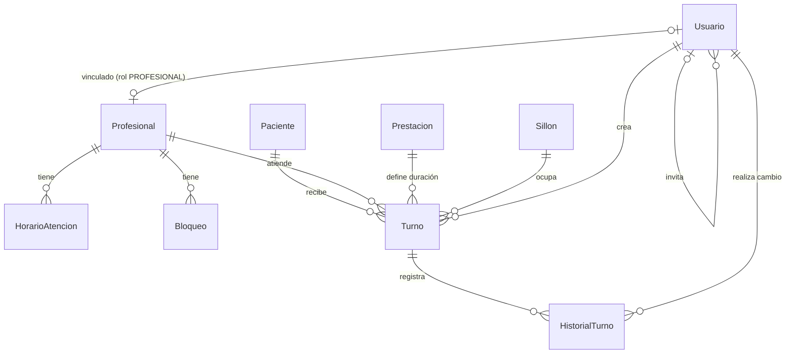

# Modelo de Datos

> Fuentes: `equipo/04-plan-lider.md` (requisitos del C01), guías de los integrantes (alcance de cada módulo), checklist de Discovery (reglas 1–7). El esquema real lo escribe el change C01 en `prisma/schema.prisma`; **solo el líder lo modifica**.

## Dominios

| Dominio | Entidades | Change que las usa |
|---|---|---|
| Acceso | `Usuario` | C01, C07 |
| Pacientes | `Paciente` | C02 |
| Catálogo | `Profesional`, `Prestacion`, `Sillon` | C03 |
| Agenda | `HorarioAtencion`, `Bloqueo` | C04 |
| Turnos | `Turno`, `HistorialTurno` | C05, C06 |

## ERD



## Convenciones

- IDs: `uuid` (`Usuario.id` = id del usuario de Supabase Auth).
- Avatares: `avatar` guarda solo el nombre del archivo (por ejemplo `avatar-06-camisa-oliva.webp`) de los 15 de `public/avatars/`. Sin avatar se muestra un ícono, nunca iniciales.
- Fechas y horas de turnos y bloqueos: `timestamptz`, guardadas en UTC; se muestran en `America/Argentina/Buenos_Aires` (UTC−3, sin horario de verano).
- Horas de una franja semanal: `"HH:mm"` en hora local del consultorio.
- Nada se borra físicamente si puede tener turnos asociados: se usa `activo = false`.
- Todas las tablas tienen `createdAt` y `updatedAt`.

## Entidades

### Usuario
- `id` uuid PK (Supabase Auth) · `email` texto único · `nombre` texto? (lo completa al activar) · `rol` enum `Rol` (`ADMIN | RECEPCION | PROFESIONAL`) · `estado` enum `EstadoUsuario` (`INVITADO | ACTIVO | INACTIVO`) · `invitadoPorId` uuid? → `Usuario` · `invitadoEn` timestamptz? · `ultimoIngreso` timestamptz? · `profesionalId` uuid? único → `Profesional` · `avatar` texto? (nombre del archivo en `public/avatars/`).
- Solo un usuario `ACTIVO` puede operar. Una invitación sin activar en 7 días vence (la valida Supabase Auth; el registro queda `INVITADO` hasta reenviarla o revocarla).
- Constraint: `profesionalId` obligatorio si `rol = PROFESIONAL`; nulo en los demás (validado en código y seed).

### Paciente
- `id` uuid PK · `nombre`, `apellido` texto · `dni` texto (solo dígitos, 7 u 8) · `fechaNacimiento` date · `telefono` texto (obligatorio) · `email` texto? · `obraSocial` texto? · `numeroAfiliado` texto? · `avatar` texto? · `activo` bool (true).
- Constraint: DNI único entre pacientes **activos** → índice único parcial `(dni) WHERE activo` (SQL manual en la migración, Prisma no lo modela).
- Índices: `apellido`, `dni`.

### Profesional
- `id` uuid PK · `nombre`, `apellido` texto · `matricula` texto **único** · `especialidad` texto? · `avatar` texto? · `activo` bool (true).

### Prestacion
- `id` uuid PK · `nombre` texto · `duracionMinutos` int · `precioReferencia` decimal(12,2)? · `activo` bool (true).
- Constraint: `duracionMinutos` entre 10 y 240 y múltiplo de 5 (CHECK en la base + validación Zod).

### Sillon
- `id` uuid PK · `nombre` texto **único** · `activo` bool (true).

### HorarioAtencion (franja semanal)
- `id` uuid PK · `profesionalId` → `Profesional` · `diaSemana` int 1–7 (1 = lunes, ISO) · `horaDesde`, `horaHasta` texto `HH:mm`.
- Constraint: `horaDesde < horaHasta`. Las franjas del mismo profesional y día no se superponen (validado en dominio, C04).

### Bloqueo
- `id` uuid PK · `profesionalId` → `Profesional` · `desde`, `hasta` timestamptz · `motivo` texto.
- Constraint: `desde < hasta`.

### Turno
- `id` uuid PK · `pacienteId` → `Paciente` · `profesionalId` → `Profesional` · `prestacionId` → `Prestacion` · `sillonId` → `Sillon` · `inicio`, `fin` timestamptz · `estado` enum `EstadoTurno` (`RESERVADO | CONFIRMADO | CANCELADO | ATENDIDO | AUSENTE`, inicial `RESERVADO`) · `motivoCancelacion` texto? · `creadoPorId` → `Usuario`.
- Constraints:
  - `CHECK (fin > inicio)`.
  - `CHECK (estado <> 'CANCELADO' OR motivoCancelacion IS NOT NULL)`.
  - **Exclusión por profesional:** `EXCLUDE USING gist (profesional_id WITH =, tstzrange(inicio, fin, '[)') WITH &&) WHERE (estado <> 'CANCELADO')`.
  - **Exclusión por sillón:** igual con `sillon_id`.
  - Requiere `CREATE EXTENSION btree_gist`. SQL manual dentro de una migración de Prisma.
- Índices: `(profesionalId, inicio)`, `(sillonId, inicio)`, `inicio`.
- `fin` = `inicio + Prestacion.duracionMinutos` al momento de crear (se guarda, no se recalcula si la prestación cambia después).

### HistorialTurno
- `id` uuid PK · `turnoId` → `Turno` · `estadoAnterior` `EstadoTurno`? (nulo en la creación) · `estadoNuevo` `EstadoTurno` · `motivo` texto? · `usuarioId` → `Usuario` · `fecha` timestamptz (now).
- Solo se inserta, nunca se edita ni se borra.

## Constante compartida

`src/domain/shared/estados.ts` (C01):

```ts
export const ESTADOS_QUE_OCUPAN_AGENDA = ["RESERVADO", "CONFIRMADO", "ATENDIDO", "AUSENTE"] as const;
export const ESTADOS_FINALES = ["CANCELADO", "ATENDIDO", "AUSENTE"] as const;
```

Debe coincidir con el `WHERE (estado <> 'CANCELADO')` de las restricciones de exclusión.

## Seed data inicial (pacientes ficticios; personal con los nombres del equipo)

| Entidad | Datos |
|---|---|
| Usuarios | 6, con los nombres del equipo (DD-17), todos `ACTIVO` y con su avatar: Francisco Valles (ADMIN, dueño), Octavio Crescini y Ulises Lucato (RECEPCION), Joaquín Cortez, Lautaro de Coninck y Joaquín Echenagorria (PROFESIONAL, vinculados a su profesional). Emails `nombre.apellido@example.com`; contraseñas solo fuera del repo. |
| Profesionales | 3: Dr. Joaquín Cortez (Odontología general), Dr. Lautaro de Coninck (Endodoncia) y Dr. Joaquín Echenagorria (Ortodoncia), con matrículas inventadas. |
| Prestaciones | 3 (por ejemplo, Consulta 30 min, Limpieza 30 min, Extracción 60 min). |
| Sillones | 3 (Sillón 1, Sillón 2, Sillón 3). |
| Horarios | Franjas de lunes a viernes para los 3 profesionales (permite probar C04 y C05 sin esperar al C04). |
| Pacientes | 5, nombres y DNI inventados, con avatar. |
| Turnos | Algunos turnos de ejemplo en estados distintos, con su historial. |
